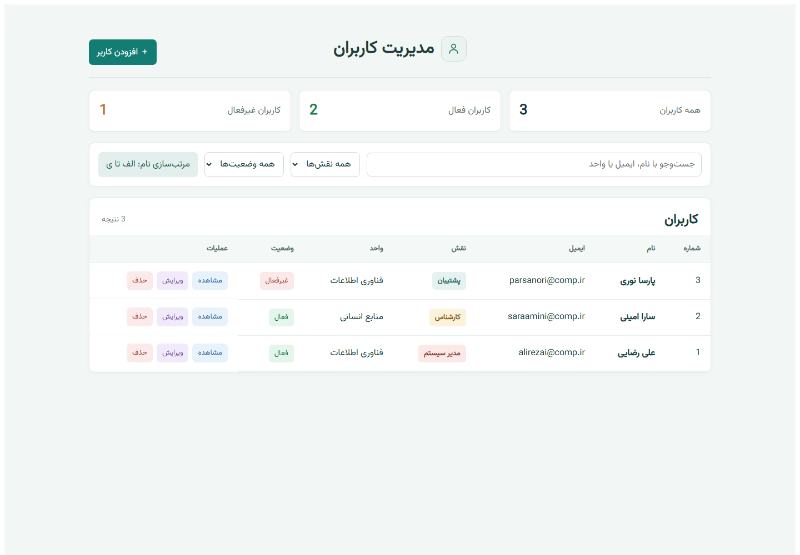

# مدیریت کاربران

یک داشبورد فارسی و راست‌چین برای نگهداری و پیدا کردن کاربران یک سازمان. این پروژه برای تمرین Angular و TypeScript ساخته شده و روی یک کار مشخص تمرکز دارد: دیدن فهرست، پیدا کردن یک کاربر و انجام عملیات معمول مدیریت حساب.



## مسئله‌ای که حل می‌کند

وقتی فهرست کاربران فقط به صورت یک جدول بلند باشد، پیدا کردن فرد مورد نظر و تشخیص نقش یا وضعیت او زمان می‌برد. این صفحه فهرست را در یک جدول قابل جست‌وجو نشان می‌دهد و عملیات هر کاربر را همان‌جا در دسترس نگه می‌دارد. نام و ایمیل به‌تنهایی برای مرتب‌کردن اعضای یک سازمان کافی نیستند؛ به همین دلیل هر رکورد در این نسخه واحد سازمانی هم دارد.

## کارهایی که می‌شود انجام داد

- **مرور فهرست:** نام، ایمیل، نقش، واحد سازمانی و وضعیت هر حساب در جدول دیده می‌شود. کارت‌های بالای صفحه تعداد کل، فعال و غیرفعال را از داده‌های فعلی محاسبه می‌کنند.
- **پیدا کردن و محدود کردن نتیجه‌ها:** جست‌وجو نام، ایمیل و واحد را بررسی می‌کند. فیلتر نقش و وضعیت با هم و با جست‌وجو ترکیب می‌شوند؛ مرتب‌سازی نام هم بین دو جهت جابه‌جا می‌شود.
- **افزودن و ویرایش:** یک فرم مشترک برای هر دو کار استفاده می‌شود. در حالت ویرایش اطلاعات همان کاربر در فرم قرار می‌گیرد و پس از ثبت، فهرست تازه می‌شود.
- **جلوگیری از ایمیل تکراری:** ایمیل پیش از ثبت با ایمیل‌های موجود مقایسه می‌شود؛ فاصله‌های ابتدا و انتها و تفاوت حروف بزرگ و کوچک نادیده گرفته می‌شوند. هنگام ویرایش، ایمیل فعلی همان کاربر مجاز است.
- **مشاهده جزئیات:** دکمهٔ «مشاهده» اطلاعات کامل‌تر را در پنجرهٔ جزئیات نشان می‌دهد.
- **حذف و بازگردانی:** حذف تأیید می‌خواهد و پیام کوتاه امکان برگرداندن آخرین حذف را می‌دهد.
- **ماندگاری در مرورگر:** تغییرها در `localStorage` ذخیره می‌شوند و با تازه‌سازی صفحه باقی می‌مانند.

## تحلیل مدل و جریان داده

### شکل دادهٔ کاربر

هر کاربر یک `id` یکتا، نام کامل، ایمیل، نقش، واحد سازمانی و مقدار `active` دارد. نقش و واحد از نوع‌های محدود TypeScript ساخته شده‌اند؛ در نتیجه فرم و دادهٔ اولیه از همان مجموعه گزینه‌ها استفاده می‌کنند و مقدار دلخواه یا ناسازگار به‌سادگی وارد مدل نمی‌شود. `UserDraft` همان شکل داده بدون شناسه است، چون شناسه را برنامه هنگام افزودن می‌سازد.

### مسیر یک تغییر

۱. قالب Angular با `[(ngModel)]` مقدار فیلترها یا فرم را به وضعیت صفحه وصل می‌کند.
۲. رویدادهای دکمه‌ها متدهای `App` را اجرا می‌کنند. کامپوننت وضعیت رابط را نگه می‌دارد؛ مثلاً اینکه فرم باز است یا کدام کاربر انتخاب شده.
۳. کارهای مربوط به داده به `UserService` سپرده می‌شوند: جست‌وجو و فیلتر، مرتب‌سازی، شمارش، بررسی ایمیل، افزودن، ویرایش، حذف و ذخیره.
۴. پس از تغییر، کامپوننت فهرست را دوباره از سرویس می‌گیرد و Angular ردیف‌ها و شمارنده‌ها را از روی دادهٔ جدید رسم می‌کند.

این جداسازی باعث شده قالب محل نگهداری منطق داده نباشد و کامپوننت هم مستقیماً با `localStorage` کار نکند.

## ساختار کد

| فایل | مسئولیت |
| --- | --- |
| `src/app/user.model.ts` | نوع `User`، نوع‌های نقش و واحد، پیش‌نویس فرم و دادهٔ اولیه |
| `src/app/user.service.ts` | عملیات فهرست، فیلترها، مرتب‌سازی، یکتایی ایمیل، CRUD و ذخیره‌سازی مرورگر |
| `src/app/app.ts` | وضعیت رابط، آماده‌کردن فرم افزودن/ویرایش و فراخوانی سرویس |
| `src/app/app.html` | جدول، فرم، فیلترها، شمارنده‌ها و پنجرهٔ جزئیات با قالب Angular |
| `src/app/app.css` | چیدمان راست‌چین، حالت موبایل، رنگ نقش‌ها و وضعیت حساب |
| `src/app/*.spec.ts` | بررسی رفتار کامپوننت و سرویس با سناریوهای مستقل |

## انتخاب‌های پیاده‌سازی

- `@for` ردیف‌ها و گزینه‌های نقش/واحد را از آرایه می‌سازد؛ `track user.id` کمک می‌کند Angular ردیف را با شناسهٔ پایدار دنبال کند.
- `@if` و `@empty` فقط فرم، جزئیات، پیام بازگردانی و حالت بدون نتیجه را هنگام نیاز نشان می‌دهند.
- `[(ngModel)]` برای فرم‌های template-driven به کار رفته و `FormsModule` در کامپوننت standalone وارد شده است.
- `UserService` داده را کپی‌شده برمی‌گرداند تا کد رابط به‌طور اتفاقی رکورد داخلی سرویس را تغییر ندهد. ویرایش و افزودن نیز آرایه را با نسخهٔ تازه جایگزین می‌کنند.
- ایمیل هنگام ذخیره trim و به حروف کوچک تبدیل می‌شود تا مقایسه و جست‌وجوی تکراری قابل اتکا باشد.
- هنگام مرتب‌سازی، ترتیب آرایهٔ اصلی تغییر نمی‌کند؛ فیلتر ابتدا نتیجهٔ تازه می‌سازد و سپس آن را مرتب می‌کند.
- کلید ذخیره‌سازی نسخه دارد (`user-management-users-v1`). اگر دادهٔ قدیمی فاقد واحد سازمانی باشد، هنگام خواندن برای آن مقدار پیش‌فرض گذاشته می‌شود. اگر دادهٔ ذخیره‌شده خراب یا غیرقابل‌خواندن باشد، فهرست نمونه بارگذاری می‌شود.
- رنگ نقش‌ها فقط برای تشخیص سریع در جدول است؛ نقش در این پروژه سطح دسترسی واقعی ایجاد نمی‌کند.

## محدودیت‌های فعلی

این تمرین سرویس سمت سرور یا پایگاه داده ندارد؛ داده فقط در مرورگر فعلی ذخیره می‌شود. ورود، احراز هویت، سطح دسترسی، صفحه‌بندی، بارگذاری تصویر کاربر و همگام‌سازی بین دستگاه‌ها پیاده‌سازی نشده‌اند. اگر دادهٔ مرورگر پاک شود، تغییرهای محلی از بین می‌روند و فهرست نمونه دوباره نمایش داده می‌شود.

## اجرا

پیش‌نیاز: Node.js و npm

```bash
npm install
npm start
```

نشانی محلی‌ای را که Angular CLI در ترمینال نشان می‌دهد در مرورگر باز کنید. برای اجرای build تولیدی:

```bash
npm run build
```

## فناوری‌ها

Angular، TypeScript، HTML، CSS، فرم‌های `FormsModule`، `localStorage` و فونت فارسی Vazirmatn که از داخل پروژه بارگذاری می‌شود.
