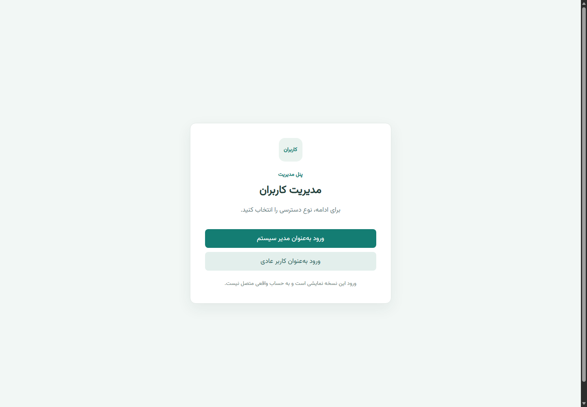
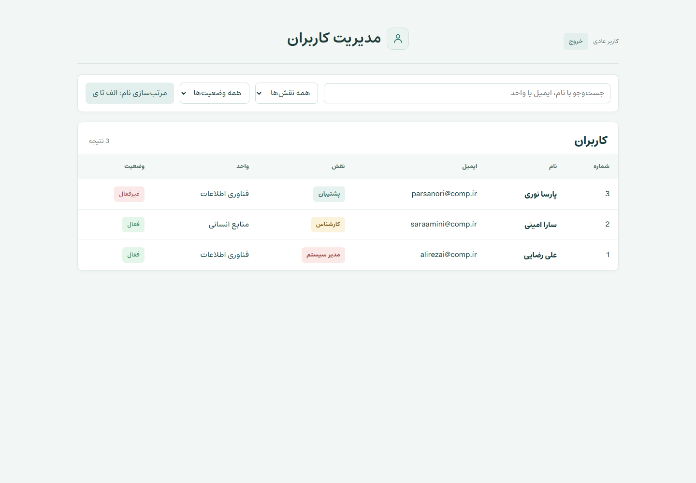

# مدیریت کاربران

یک تمرین ساده با Angular برای نمایش و مدیریت فهرست کاربران.

## ورود و سطح دسترسی

در صفحهٔ ورود می‌توان نقش مدیر یا کاربر عادی را انتخاب کرد. مدیر به فرم‌ها و عملیات مدیریت دسترسی دارد؛ کاربر عادی فقط فهرست را می‌بیند. مسیرهای برنامه با `AuthGuard` محافظت می‌شوند.



## فهرست کاربران

نام، ایمیل، نقش، واحد سازمانی و وضعیت هر کاربر در جدول نمایش داده می‌شود. جست‌وجو و فیلتر نقش و وضعیت کمک می‌کنند نتیجه‌ها سریع‌تر پیدا شوند.


## افزودن و ویرایش

فرم مدیر برای ثبت کاربر و به‌روزرسانی اطلاعات استفاده می‌شود. ایمیل تکراری پذیرفته نمی‌شود.

## حذف و مشاهدهٔ جزئیات

مدیر می‌تواند جزئیات هر کاربر را باز کند یا پس از تأیید، او را حذف کند. کاربر عادی امکان تغییر اطلاعات را ندارد.



## نگهداری فهرست

اطلاعات کاربران در مرورگر ذخیره می‌شوند تا پس از تازه‌کردن صفحه باقی بمانند.

## اجرا

```bash
npm install
npm start
```
